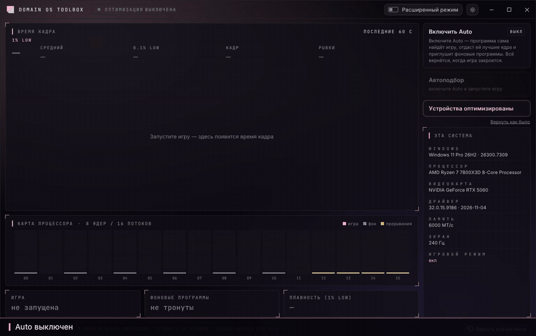

# DomainScheduler

[English](README.md) | **Русский**



**Сайт:** [6kane1.github.io/DomainOS](https://6kane1.github.io/DomainOS/ru/) · **Гайды:** [фризы в CS2](https://6kane1.github.io/DomainOS/ru/guide-cs2-stutter.html) · [1% low и 0.1% low](https://6kane1.github.io/DomainOS/ru/guide-1-percent-low.html) · [DPC и прерывания](https://6kane1.github.io/DomainOS/ru/guide-dpc-latency.html) · **[Discord](https://discord.gg/wBGsV7WEpm)**

Утилита для Windows, работающая в пользовательском режиме: настраивает, как планировщик
размещает потоки игры и сколько ресурсов достаётся фоновым программам. Цель — **более ровное
время кадра**: лучше 1% и 0.1% low и стабильнее подача кадров. Средний FPS программа не повышает.

С 1.17.0 это нативная программа: логика — библиотека на Rust, окно — C++20 с Dear ImGui и DirectX 11, и всё
связано в один статический `DomainScheduler.exe` размером около 8 МБ. Поведение, хранение данных, ключи командной
строки и задание планировщика те же, что у Toolbox на C# 1.16.x (см.
[Совместимость с Toolbox на C#](#совместимость-с-toolbox-на-c)).

> **Прочтите перед использованием**
> - **Средний FPS не увеличивается.** Программа не делает процессор или видеокарту быстрее. Она
>   работает с худшими кадрами: 1% low, 0.1% low, p99 времени кадра.
> - **Прирост будет не на каждом ПК.** На части сборок разница укладывается в погрешность
>   измерений, на некоторых может быть отрицательной. Измеряйте на своей системе (см.
>   [Как проверить эффект](#как-проверить-эффект)).
> - Ровное время кадра даёт и более *стабильную* задержку от ввода до экрана. Саму задержку ввода
>   программа не измеряет и напрямую не уменьшает.
> - Все изменения откатываются при закрытии игры, при выключении и при выходе. После сбоя
>   следующий запуск сам возвращает изменённое.

## Что делает программа

- **Режим одной кнопки (Auto).** Находит игру из списка наблюдения, выбирает для неё ядра (с
  учётом кэша на двухкристальных X3D и P/E-ядер на гибридных Intel), ставит класс приоритета
  «Выше среднего», даёт ключевым потокам по предпочтительному ядру и понижает фоновые программы.
- **Dynamic Top-5.** Пять самых нагруженных потоков игры переоцениваются каждую секунду и
  переезжают между ядрами и приоритетами вслед за нагрузкой. (Старый режим «ролевой план» убран в
  1.16.0 Test 1.9: в замерах разработчика он только ухудшал результат.)
- **Идеальные ядра всем потокам игры** (1.17.1, настройки и страница потоков игры, включено). С Auto каждый остальной
  поток игры (и потоки DLL) получает предпочтительное ядро: никогда ядро 0, никогда ядро Top-5 (его SMT-сосед только
  после всех свободных ядер), никогда ядро, занятое драйверами (DPC/ISR по живой трассе, держится 60 с), на гибридных
  процессорах только P-ядра, внутри маски ядер, если она включена. Новые потоки получают ядро примерно за 2 с; поток
  переезжает только по явной причине (гистерезис 3 тика, 2 с на месте, не больше 2 переносов в секунду). Пишется только
  идеальный процессор: без аффинити, без CPU Sets, без приоритета; потоки по-прежнему мигрируют. Поток, вошедший в
  Top-5, принадлежит Top-5; значение, поставленное кем-то другим, не трогается; выключение Auto возвращает только те
  значения, которые всё ещё стоят от Toolbox.
- **Список наблюдения и защитный список.** Настраиваются только программы, которые вы отметили
  сами. Системно-критичные процессы и античиты не открываются и не изменяются.
- **Фоновый слой.** Пока запущена игра из списка, остальные программы получают приоритет «Ниже
  среднего», самый низкий приоритет ввода-вывода, низкий приоритет памяти, EcoQoS и, где это
  имеет смысл, неигровые ядра.
- **Встроенные пресеты** для компонентов Windows и популярных фоновых программ; свои пресеты с
  импортом, экспортом и профилями.
- **Маски ядер**: наглядная карта процессора, учёт прерываний устройств, резервирование ядер.
- **Страница устройств**: просмотр привязки прерываний (запись — отдельная функция, с 1.16.0 открыта, перед записью спрашивает подтверждение).
- **Контроль времени кадра.** Если p99 после изменений стал хуже, изменения снимаются, кадры
  измеряются заново, и откат остаётся, только если ухудшение настоящее.
- **Страница «Проверка»** (1.16.0 Test 1.1): один замер на 30 секунд, пока вы играете, — FPS, 1% / 0.1% low, самый
  долгий кадр, рывки и сколько потоки игры ждут процессор; отчёт сохраняется на рабочий стол. Игра не открывается
  (только трасса ядра и кадры DXGI).
- **Карта потоков** (1.17.0, раздел планировщика): процессы и потоки игры как живой граф (кто кого будит, кто ждёт
  чужую блокировку, кто занимает чьё ядро, кто к кому обращается) за последние 30 с. Её трасса ядра работает, только
  пока страница на экране.
- **Очистка кэшей**, автозапуск через планировщик заданий, отчёт в один клик, цветной журнал. Программа меряет
  собственную нагрузку по потокам; если потоки вне известного списка занимают четверть ядра и больше, журнал называет их.

Без драйвера ядра, без внедрения DLL, без перехватов и без правки памяти — только
документированные функции Windows (affinity, CPU Sets, ideal processor, классы приоритета,
приоритет и boost потоков, приоритеты ввода-вывода и памяти, EcoQoS). Данные не покидают компьютер.

## Требования

- Windows 10 (1903 и новее) или Windows 11, x64
- Права администратора (программа запрашивает их при запуске)
- Ничего устанавливать не нужно: сборка — один статический exe (около 8 МБ)

## Быстрый старт

1. Запустите `DomainScheduler.exe`.
2. Проверьте, что игра есть в списке наблюдения (`cs2.exe` там по умолчанию; другие добавляются
   на страницах **Processes** или **Settings**).
3. Нажмите **Turn on** и запустите игру. Подержите её на переднем плане несколько секунд.
4. Чтобы всё вернуть: **Turn off**, **Revert** или выход через значок в трее.

Интерфейс на английском и русском языках.

## Рекомендуемые настройки по процессорам

Значения по умолчанию подобраны как безопасные. Маску Auto выбирает сам; в таблице — что именно
он выбирает и что стоит попробовать вручную.

| Процессор | Что делает Auto | Что попробовать | Чего ждать |
|---|---|---|---|
| **X3D с двумя CCD** — 7900X3D, 7950X3D, 9900X3D, 9950X3D | Игра на CCD с большим кэшем (`vcache`), фон на втором CCD | Резервирование неигрового CCD (страница Masks, нужна перезагрузка) — только после замера с настройками по умолчанию | Семейство, где выигрыш вероятнее всего |
| **Гибридные Intel** — 12–14 поколение, Core Ultra | Игра на P-ядрах (`pcores`), фон на E-ядрах | `nosmt` (один поток на P-ядро) — проверить оба варианта | Обычно заметно на low, когда фоновая нагрузка реальна |
| **X3D с одним CCD** — 5800X3D, 7800X3D, 9800X3D | Делить нечего: маска `auto`, потоки по физическим ядрам, фон понижен | `nocore0` | Небольшой эффект, в основном от фонового слоя |
| **Ryzen с двумя равными CCD** — 5900X, 5950X, 7900X, 7950X, 9900X, 9950X | Автоматического разделения нет (кэши равны) | Маска `ccd0` или `ccd1` вручную, чтобы игра жила в одном CCD — проверить оба | Зависит от игры, может быть и хуже |
| **Обычные процессоры с одним доменом** — Ryzen 5600 / 5700X / 7600 / 7700, Intel до 11 поколения | Маска `auto`, приоритеты, фон понижен | `nocore0` при 8 ядрах и больше | Небольшой, многого не ждите |
| **Меньше 6 ядер** | Только приоритеты и фон; маска не режется ниже 4 логических процессоров | Оставить по умолчанию | Часто никакого: свободных ядер нет |
| **Больше 64 логических процессоров или несколько групп** | Работает только в группе 0; без разделения и резервирования | — | Не целевая платформа |

Настройки, общие для всех процессоров:

| Настройка | Рекомендация |
|---|---|
| Auto | **Включить** — это основной режим |
| Встроенные системные пресеты, фоновый слой (`BgOn`), warm-up | **Включены** (по умолчанию) |
| Thread CPU Sets (жёсткая привязка потока к ядру) | **Выключено**. Свободная миграция обычно лучше |
| SMT / Hyper-Threading | Оставить **включённым** в BIOS; для проверки без него есть `nosmt` в маске |
| Флаги функций | Запись политики устройств и разгон видеокарты **открыты** с 1.16.0 (оба спрашивают перед записью); таймер, флаг живых DPC/ISR и мягкое закрытие **закрыты**, пока вы точно не знаете, зачем они нужны |
| Heat-политика в пресетах | `none` |

## Как проверить эффект

1. Выберите повторяемую сцену (одна карта, одна демка или бенчмарк).
2. Запишите 1% low, 0.1% low и p99 времени кадра в CapFrameX или PresentMon: три прогона с
   выключенной программой и три с включённой.
3. Сравнивайте *типичные* значения. Разница в несколько процентов — шум.
4. Если low на вашей системе не выросли, программе здесь нечего дать — выключите её, ничего
   изменённого не останется.

## Честные ограничения

- Ideal processor — подсказка: Windows может её не учесть.
- Распознавание потоков — эвристика; в играх без имён потоков остаются только маска и приоритеты.
- На двухкристальных X3D CCD с большим кэшем лучше для большинства игр, но не для каждой.
- Если игра упирается в видеокарту, планированием процессора мало что изменишь.
- Пока запущен клиент античита, защищающий игру (например, FACEIT с CS2), сама игра не трогается
  совсем; работает только фоновый слой. Игры под античитами уровня ядра (Vanguard, EasyAntiCheat,
  BattlEye и другие) не открываются никогда. Перед использованием любых сторонних программ
  проверьте правила своей лиги или платформы.
- Встроенные пресеты — отправная точка; проверьте их под свой набор программ.
- Программа работает с правами администратора (без запроса UAC — только если в плейбуке отмечена эта опция; с
  плейбука 2.1.9 она по умолчанию выключена). Всё, что она
  восстанавливает или делает сама, хранится там, куда пишут только администраторы (см. ниже), а каждое
  восстанавливаемое значение сверяется с тем, что программа пишет сама. С 1.17.0 программа — один статический exe
  без среды выполнения: при запуске ничего не распаковывается в `%TEMP%` (у Toolbox на C# 1.16.x и старше среда .NET
  распаковывала туда нативные библиотеки при первом запуске). Когда запросы UAC выключены, любая программа учётной записи администратора и так может получить права
  администратора; эти защиты важнее всего при включённых запросах UAC.

## Разгон видеокарты

За отдельным флагом функции (Настройки → флаги функций → разгон видеокарты, с 1.16.0 открыт по умолчанию; ничего не пишется, пока вы не примените профиль) страница
«Видеокарта» предлагает небольшой осторожный разгон с именованными профилями; один из них можно применять при каждом
запуске.

- **NVIDIA** (через драйвер NVIDIA): смещения частот ядра и памяти и прибавка напряжения (0–100 % от того, что
  разрешает производитель).
- **AMD Radeon** (через собственный интерфейс драйвера AMD, `atiadlxx.dll`, который ставится с любым драйвером Radeon):
  - RX 5000/6000/7000/9000 (Overdrive8): максимальная частота GPU, максимальная частота памяти, лимит мощности
    (в процентах) и, если драйвер это предлагает, смещение напряжения — только вниз (андервольт), никогда вверх;
  - Polaris RX 470/480/570/580/590 и Vega 56/64 (OverdriveN): частота верхнего состояния производительности GPU и
    памяти и лимит мощности. Нижние состояния и все напряжения записываются обратно ровно такими, какими их сообщает
    драйвер.
  - Используются только активные адаптеры физической карты (по одному на карту; встроенная графика Radeon не
    затрагивается).
- Частоты для обоих производителей хранятся как **смещения от стандартных значений карты** (у AMD — от стандартной
  максимальной частоты, которую сообщает драйвер; она читается заново при каждом применении), поэтому профиль никогда
  не содержит абсолютную частоту. Каждое значение обрезается до диапазона драйвера, его шага и собственных
  ограничений программы (+300 МГц ядро, +1500 МГц память, не ниже −300 МГц) и после записи читается обратно.
- **Сбросить к стандарту** записывает собственные стандартные значения драйвера (AMD Overdrive8 — флаг сброса драйвера
  с его значениями по умолчанию; OverdriveN — стандартная таблица состояний драйвера, лимит мощности снова
  автоматический). Всё читается заново, поэтому сброс работает и после неудачного применения, и в новом сеансе.
- **Применять при запуске** повторно применяет отмеченный профиль только на карте того производителя, для которого он
  сохранён, и никогда — если после последнего применения Windows аварийно завершилась (синий экран, зависание с
  отключением питания): защита от сбоев одинакова для обоих производителей. Значения, с которыми Windows упала,
  запоминаются (с 1.16.0 Test 1): если снова отметить «при запуске» те же или более высокие значения, программа сначала
  спросит (по умолчанию «Нет»), а у профиля видна дата сбоя.
- Нет управления вентиляторами, нет таймингов памяти, никакие процессы не закрываются. Если драйвера или его
  интерфейса разгона нет, страница прямо об этом говорит и ничего не записывается. Поддержка AMD появилась в 1.15.0
  Test 1.5 и ещё не запускалась на настоящих картах Radeon: пожалуйста, сообщите модель карты, версию драйвера и то,
  что показала страница.

## Состояние проекта

Версия **1.17.1** (приходит через обновление самого Toolbox). Новое после 1.17.0:

- **Идеальные ядра всем потокам игры**: Dynamic Top-5 теперь ведёт и все остальные потоки игры (и потоки DLL) на том же
  секундном тике: каждый получает предпочтительное ядро не на ядре 0, не на ядрах Top-5 и не на ядрах, занятых
  драйверами, и переезжает только по явной причине. Переключатель в настройках и на странице потоков игры (включено),
  там же короткая строка о сделанном и последние переносы. На 7800X3D разработчика (Top-5 на 2, 4, 6, 8, 10, графический
  драйвер на 12-15) остальные потоки идут на 3, 5, 7, 9 и 11. Тик стоит около 7 мкс на 150 потоков и не выделяет память.

Версия **1.17.0** (идёт с плейбуком 2.3.2, собрана и аттестована GitHub, в [Releases](https://github.com/6kane1/DomainOS/releases)). Новое после 1.16.1:

- **Нативная программа**: тот же Toolbox, собранный заново как ядро на Rust и окно на C++20 (Dear ImGui, DirectX 11,
  Win32), один статический exe около 8 МБ вместо самодостаточного exe на .NET 8 / WPF около 71 МБ. То же имя exe,
  папка установки, задание планировщика, настройки, папка состояния, ключи командной строки и ключи обновлений. Окно
  перерисовывается только при вводе, по таймеру, который попросила страница, или когда изменилось состояние программы.
- **Внешний вид**: статичный тёмный фон с мягким розовым и фиолетовым свечением, полупрозрачные панели, мягкие кнопки.
- **Страница «Обзор»**: ряда «Boost / Reapply / Resync / Revert» больше нет. Auto сам усиливает и применяет заново, а
  Revert делал то же, что «Вернуть всё как было» в панели статуса. «Resync» теперь — **«Перечитать железо и пресеты»** в
  расширенной части настроек.
- Страница **«Карта потоков»** (раздел планировщика), см. [Что делает программа](#что-делает-программа).
- Из тестовых сборок 1.16.2: защита от всплесков больше никогда не ограничивает собственные процессы драйвера видеокарты (контейнеры, панели и оверлеи NVIDIA и AMD) и DomainSchedTest, поэтому замеры остаются точными. **CS2 под FACEIT** теперь тоже настраивается (переключатель в настройках, включён): FACEIT письменно подтвердил 25.11.2026, что их античит это разрешает; только CS2 и только FACEIT, остальные античиты не трогаются. Маска ядер используется только на процессорах больше чем с 8 ядрами двух видов (Intel с E-ядрами, Ryzen с двумя CCD). Чёрный ящик теперь **выключен по умолчанию** (переключатель в настройках). На странице изменений системы остались только фоновая запись игр, ускорение указателя и две настройки Windows Update (настройки приватности, рекламы и интерфейса по-прежнему ставит плейбук).

Версия **1.16.1** (шла с плейбуком 2.3.1). Новое после 1.16.0:

- **Датчик ожиданий** (настройки, включён): пока Auto ведёт игру, трасса ядра на 250 мс каждые 2 с добавляет переключения контекста, готовые потоки и жёсткие промахи страниц. Dynamic Top-5 выбирает потоки игры по загрузке **и** по их p99 ожидания ядра (поток, ждущий 1 мс, весит как 30% нагрузки), а слот уходит с процессора по одной из трёх отдельных причин: процессор заняли другие программы (без времени прерываний), драйверы занимают больше 5% в DPC/ISR или его собственный поток всё время ждёт (p99 больше 0.5 мс).
- **Маска ядер**: процессоры с одним кэшем и без E-ядер отдают игре все ядра при любом числе ядер (раньше только до 6). На 7800X3D разработчика с маской главные потоки игры ждали ядро 13 раз за 30 с в CS2 DM, а самое долгое ожидание было 940 мкс (без маски 202 мкс), при одинаковых 1% и 0.1% low. Кнопка **«Маска ядер»** на странице потоков игры выключает или включает её одним нажатием (Auto подхватывает примерно за 10 с), рядом короткая инструкция, как её проверить.
- **Ядра драйвера видеокарты и прерываний держатся 60 с**: ядро драйвера остаётся отмеченным, пока драйвер 60 с на нём молчит, ядро с прерываниями отпускается после 60 с затишья (забирается через 20 с), поэтому потоки игры больше не переставляются каждые несколько секунд.
- **Защита от всплесков и память**: память игры удерживается, только когда игра читает больше 30 своих страниц в секунду обратно с диска, и удержание снимается через 10 с, если оно не уменьшило их вдвое.
- **Чёрный ящик** (страница в разделе планировщика, переключатель в настройках, включён): трасса ядра Windows и кадры игры хранятся в памяти примерно 30 с; кадр дольше трёх медианных и двух обновлений монитора объясняется простыми словами (игра или видеокарта, драйвер, другая программа, не хватило свободных ядер) с советом; кадры от 100 мс считаются загрузкой; процессам Windows никогда не советуется «закрыть». Только читает, на диск пишет лишь маленькие JSON-отчёты (последние 50).
- Ленты обновлений также выкладываются одним файлом с подписью внутри (`*.signed`); смена языка больше не спотыкается о панель статуса.

Замер на Ryzen 7 7800X3D + RTX 5060 разработчика (CS2 DM, 3 прогона по 30 с, маска выключена): 1% low 429, 0.1% low 230, самое долгое ожидание ядра потоком игры 183 мкс, ни одного ожидания главного потока игры дольше 0.5 мс.

Предыдущая версия **1.16.0** (шла с плейбуком 2.3.0). Новое после 1.15.0:

- **«Обновления и тесты»**: одна страница для проверки обновлений, возврата к прошлой версии, ключа тестировщика и канала обновлений (были в «О программе» и в настройках).
- **Dynamic Top-5 единственный режим потоков**: ролевой план убран, в замерах разработчика он только ухудшал результат.
- **Устройства**: вместо большой таблицы одна строка и кнопка «Применить раскладку»; в подтверждении видно, какое устройство получит какое ядро. Если раскладка уже стоит, применять нечего.
- **Защита от фоновых всплесков** (настройки, включена, мягкий режим): пока идёт игра, фоновая программа вашего сеанса, которая 6 с подряд занимает 0.3 процессора и больше, получает минимальный вес собственного Job Object: она никогда не останавливается, а только уступает, когда процессоры заняты (мягкий режим выключен: жёсткий предел в половину процессора). Дочерние процессы из него выходят, поэтому запущенная из неё игра никогда не ограничивается. Снимается, когда вы переключаетесь на эту программу, когда игра заканчивается, Auto выключается или Toolbox закрывается, а после сбоя при следующем запуске. Службы, лаунчеры, оболочка, звук / голос / стриминг / VR, сетевые ускорители, защита и античиты не трогаются. Только когда свободной памяти мало (меньше 10% ОЗУ или 1.5 ГБ), игра удерживает свою текущую память как жёсткий минимум (не больше 25% ОЗУ). На чистом ПК ничего не делает; после игры в журнале видно, что ограничивалось.
- **6 ядер и меньше** (один кэш, без E-ядер): Auto отдаёт игре все ядра, а раскладка устройств не выделяет устройствам своих ядер. У тестера на i5-10400F старая маска стоила 6% 1% low в CS2. 8 ядер и больше работают как в 1.15.0. Настройка `AutoMask` auto | on | off (`--auto-mask`), `--auto on|off|status` для автоматических замеров.
- Страница «Проверка» (один замер), память сбоев разгона видеокарты, своя нагрузка по потокам, тексты в настройках короче.

Тестовые сборки зашифрованы и лежат в приватном репозитории, который видят только разработчик и приглашённые тестировщики. 401 автотест работает на имитации Windows (`cargo test`, см. [Тесты](#тесты)), включая fuzz-тесты разборщиков внешних данных и учения по ротации ключа. Проверено на небольшом числе конфигураций: пишите в issues свой процессор, сборку Windows и цифры до и после.

## Сборка из исходников

Исходник нативного Toolbox (1.17.0 и новее). Он опубликован в `toolbox/` репозитория
[6kane1/DomainOS](https://github.com/6kane1/DomainOS) и в корне
[6kane1/DomainScheduler](https://github.com/6kane1/DomainScheduler); исходник на C# версий 1.16.x и старше остаётся в
ветке `csharp` репозитория 6kane1/DomainScheduler.

### Структура

```
core/                крейт Rust dos_core: вся логика; статическая библиотека для exe (libdos_core.a), rlib для тестов
  src/base           общие типы, настройки, переводы, журнал, флаги функций, папка состояния, версия
  src/native         вызовы Windows за трейтом и имитация Windows, на которой идут тесты
  src/topo           топология процессора, маски ядер, разделение ядер, раскладка прерываний, резервирование ядер
  src/engine         приоритеты, фоновый слой, защита (защитный список, античиты), сессия, встроенные таблицы
  src/auto           Auto, Dynamic Top-5, защита от всплесков, тюнер, HUD, статистика страницы «Проверка»
  src/etw            трассы ядра: DPC/ISR, кадры, датчик ожиданий, чёрный ящик, трасса «Проверки», трасса карты потоков
  src/system         хранилище, обновления, автозапуск, защита загрузки, перенос старых данных, изменения системы,
                     устройства, обслуживание
  src/gpu            разгон видеокарты (NVIDIA, AMD) и его профили
  src/ffi            C ABI для приложения (заголовок app/src/dos_core.h): долгоживущие объекты, запуск, командная
                     строка, единственный экземпляр, передача обновления
  res/               встраивается в exe: lang/ (en.json, ru.json, tables.json, threads.ini), ru.native.json
  tests/             интеграционные тесты (parity_gaps.rs), образцы подписей для тестов (data/sigsample)
threadmap/           крейт Rust threadmap: логика карты потоков (граф, история, раскладка), входит в dos_core (threadmap.h)
app/                 окно: C++20, Dear ImGui + DirectX 11 + Win32; логики нет, всё, что решает или меняет, — вызов ядра
  src/               оболочка (main, рамка окна, боковая панель, тема, элементы, трей, окно ошибки, графики, мост к ядру)
  src/pages/         по файлу на страницу
  src/app.rc         значок, манифест, встроенные шрифты
  third_party/imgui  Dear ImGui 1.92.9b (лежит в репозитории, со своим LICENSE.txt)
  res/               app.ico, app.manifest (администратор, DPI per-monitor v2), Fonts/ (Inter, JetBrains Mono)
tools/sync-lang.sh   обновляет core/res/lang из исходника на C#
build.sh             вся сборка
LICENSE
```

### Инструменты и сборка

Exe для Windows собирается на Linux:

- Rust **1.100.0** с целью `x86_64-pc-windows-gnullvm`;
- **llvm-mingw 20260922** (`llvm-mingw-20260922-ucrt-ubuntu-22.04-x86_64`): `x86_64-w64-mingw32-clang++`, `windres`,
  `llvm-strip`.

`./build.sh` выполняет по порядку: `cargo test` (core с `--features testsupport`, threadmap), `cargo build --locked
--release --target x86_64-pc-windows-gnullvm` (статическая библиотека `libdos_core.a`), затем
`x86_64-w64-mingw32-clang++` компилирует Dear ImGui и `app/src`, `windres` — `app/src/app.rc`, всё связывается в один
статический exe, и `llvm-strip` его очищает. Результат — `out/DomainScheduler.exe` (около 8 МБ).

| Параметр | Что делает |
|---|---|
| `./build.sh --no-test` | без `cargo test` |
| `OUT=путь/DomainScheduler.exe` | куда записать exe (по умолчанию `out/DomainScheduler.exe`) |
| `OBJ=папка` | папка для объектных файлов C++ (по умолчанию `obj`, удаляется после сборки) |
| `CARGO_TARGET_DIR=папка` | своя папка сборки Cargo (вместе с `OBJ`: несколько сборок параллельно) |
| `MINGW=путь` | папка `bin` llvm-mingw (по умолчанию `~/sdk/llvm-mingw-20260922-ucrt-ubuntu-22.04-x86_64/bin`) |
| `NO_CORE=1` | только приложение на `app/src/core_stub.cpp`, без сборки Rust (для работы над окном) |

`RUSTUP_HOME` и `CARGO_HOME` по умолчанию — `~/sdk/rust/rustup` и `~/sdk/rust/cargo`.

**У версии один источник:** `version` в `core/Cargo.toml`. Программа читает её при сборке
(`env!("CARGO_PKG_VERSION")`), а сборка записывает её в свойства файла exe (VERSIONINFO).

**Общие файлы ресурсов:** `core/res/lang/{en.json,ru.json,tables.json,threads.ini}` — те же переводы, встроенные
таблицы и имена потоков, что в Toolbox на C#, лежат здесь копией; `tools/sync-lang.sh` обновляет их из исходника на C#.
Тексты, которые есть только в нативном Toolbox, переведены в `core/res/ru.native.json`; при запуске он накладывается
поверх `ru.json`.

Сторонний код: крейты Rust serde, serde_json, sha2, p256, aes-gcm, base64, indexmap и windows-sys (точные версии в
`Cargo.lock`), Dear ImGui 1.92.9b (MIT), шрифты Inter и JetBrains Mono (SIL Open Font License 1.1, встроены в exe).

### Тесты

```
cd core && cargo test --locked --features testsupport   # 344 модульных теста + 4 интеграционных (tests/parity_gaps.rs)
cd threadmap && cargo test --locked                     # 28 тестов
```

На Linux 401 тест. Сборка тестов для Windows запускает 364 теста core (6 из них есть только в Windows). Логика
работает на имитации Windows, поэтому на ПК ничего не меняется. На GitHub `tests.yml` гоняет эти тесты на Ubuntu
(область G в `tests/run-all.py`) и на windows-latest.

### Доказательство, что exe собран из этого исходника

`.github/workflows/toolbox-build.yml` репозитория 6kane1/DomainOS собирает Toolbox на машинах GitHub (ubuntu-latest):
закреплённые инструменты (`.github/actions/native-toolchain`, llvm-mingw проверяется по SHA-256), сначала тесты, крейты
ровно как в `Cargo.lock` (`--locked`), пути сборки убраны из exe (`--remap-path-prefix`). Каждый exe получает
подписанное подтверждение происхождения сборки и аттестованный SBOM в формате SPDX (`tools/make-sbom-native.py`:
крейты, Dear ImGui, шрифты, инструменты сборки). Проверить любую копию можно через GitHub CLI:

```
gh attestation verify DomainOS-Toolbox-1.17.1.exe -R 6kane1/DomainOS
```

## Совместимость с Toolbox на C#

Нативный Toolbox заменяет Toolbox на C# (WPF, .NET 8, до 1.16.x) и сохраняет всё, на что опираются другие части
Domain OS: имя exe `DomainScheduler.exe`, папку установки `C:\Program Files\Domain OS`, задание планировщика
`DomainScheduler`, настройки в `HKCU\Software\DomainScheduler` и `HKLM\SOFTWARE\Domain OS\Toolbox`, папку состояния
`%ProgramData%\Domain OS Toolbox` с теми же файлами, те же ключи командной строки (`--auto on|off|status`,
`--auto-mask`, `--after-update` и остальные) и те же ключи подписи обновлений. Плейбук и Undo работают с обоими.

**Ленты обновлений:** нативный Toolbox читает `update/stable-native.json` и закрытую тестовую ленту
`update/test-native.bin`. Toolbox на C# 1.16.x по-прежнему читает `update/stable.json` и `update/test.bin`; в
`stable.json` остаётся запись 1.16.1. Поэтому Toolbox на C# **не** обновляется до нативного сам: нативный приходит с
плейбуком 2.3.2, установленным через AME Wizard поверх Domain OS. Toolbox на C# показывает карточку, когда вышел
плейбук 2.3.2, и может его скачать.

## Где хранятся данные

- **Папка состояния** `%ProgramData%\Domain OS Toolbox` — пресеты, профили, профили видеокарты, резервные копии
  изменений устройств, реестра, питания и резервирования ядер, файл сессии на случай сбоя, защита загрузки устройств,
  журнал и загрузки обновлений (`Updates`); в `native` лежат нативные библиотеки, которые распаковывал Toolbox на C#
  1.16.x и старше (нативному Toolbox распаковывать нечего). Изменять в ней
  что-либо могут только SYSTEM и администраторы, остальные учётные записи — только читать. Разработчик и права
  проверяются при каждом запуске: папка, в которую мог писать кто-то другой, переименовывается в
  `…untrusted-<время>`, не читается, и создаётся новая.
- **Настройки, из-за которых программа действует сама** (флаги функций, разгон видеокарты при запуске, разовые
  очистки): `HKLM\SOFTWARE\Domain OS\Toolbox` (только администраторы).
- **Настройки окна** (язык, положение, графики, список игр, выбор маски): `HKCU\Software\DomainScheduler`.
- Автозапуск: задание планировщика `DomainScheduler`.
- **Settings → Factory reset** удаляет всё перечисленное.

Версии до 1.15.0 Test 1.3 хранили данные в `%LOCALAPPDATA%\DomainScheduler`, которую может менять любая программа
вашей учётной записи. При запуске программа один раз переносит эти файлы — только те записи, которые могла написать
сама (подложенная запись отбрасывается и называется в журнале), — и переименовывает старые файлы в `*.migrated`.
Флаги функций и разовые отметки так же один раз копируются из HKCU в HKLM. Профиль видеокарты с отметкой «применять
при запуске» не применяется из старого файла как есть: при первом запуске программа один раз спрашивает в своём окне,
показывая значения профиля, применять ли его при запуске дальше («Да» оставляет отметку, «Нет» снимает; профиль
остаётся в списке).

Каждая резервная копия проверяется заново при восстановлении: возвращаются только те ключи, имена, типы и диапазоны
значений, которые программа пишет сама; всё остальное отклоняется и записывается в журнал. Дочерние процессы
(PowerShell, schtasks, bcdedit, wevtutil…) запускаются из System32 по полному пути; PowerShell работает без профиля и
видит только модули самой Windows, и никакое значение не подставляется в командную строку текстом.

## Ключи обновлений и их смена

Ленты обновлений (`update/stable-native.json`, закрытая тестовая лента `update/test-native.bin`; Toolbox на C# 1.16.x
читает `update/stable.json` и `update/test.bin`) подписаны ECDSA P-256; `.sig` рядом с каждой — подпись DER в base64
над SHA-256, её делает `DomainOS/tools/sign-feed.sh`. Toolbox доверяет короткому списку открытых ключей
(`Updater::trusted_keys()` в `core/src/system/updater.rs`): лента принимается, если подпись сходится с **любым** из них. Формат
`.sig` не менялся и не содержит id ключа, поэтому ленты, подписанные основным ключом, работают во всех уже
установленных версиях Toolbox, а новый код просто проверяет каждый доверенный ключ по очереди.

| Ключ | Id (SHA-256 открытого ключа, первые 16 hex) | Где хранится закрытая часть |
|---|---|---|
| основной | `824da223f01c0905` | ПК автора (плюс копия офлайн) |
| запасной | `a807a74083942dde` | только офлайн (флешка / бумага) |

`Updater::REVOKED_KEY_IDS` — список ключей, которым больше нельзя доверять. Он сверяется с отпечатком, посчитанным по
самому ключу, поэтому отозванный ключ отклоняется, даже если он всё ещё стоит в списке доверенных.

**Если основной ключ утёк или потерян:**

1. Больше не подписывать им. Создать новую пару: `openssl ecparam -name prime256v1 -genkey -noout | openssl pkcs8
   -topk8 -nocrypt -out NEW.pem` (`chmod 600 NEW.pem`); её открытый ключ: `openssl pkey -in NEW.pem -pubout -outform DER | base64 -w0`.
2. В `core/src/system/updater.rs` старый запасной ключ становится `PUBLIC_KEY` (основным), новый —
   `BACKUP_PUBLIC_KEY`, id в `trusted_keys()` обновляются (их проверяет тест `built_in_key_list_is_consistent`), а id
   утёкшего ключа добавляется в `REVOKED_KEY_IDS`. Собрать и проверить этот Toolbox. Toolbox на C# 1.16.x по-прежнему
   читает `update/stable.json` и доверяет тем же двум ключам: сделать ту же замену в его `Updater.cs` (ветка `csharp`
   репозитория 6kane1/DomainScheduler) и выпустить эту сборку в `stable.json`.
3. Ленты, в которых они выходят, подписать запасным ключом:
   `DOMAINOS_SIGNING_KEY_BACKUP=/путь/на/флешке.pem sign-feed.sh --backup update/stable-native.json` (и
   `test-native.bin`, `stable.json`, `test.bin`).
   Установленные версии уже доверяют запасному ключу, поэтому примут ленту и обновятся до версии, которая больше не
   доверяет скомпрометированному ключу.
4. Старый запасной ключ теперь основной ключ подписи; `NEW.pem` хранить офлайн как следующий запасной; все копии
   скомпрометированного ключа удалить.

Если потерян или утёк только запасной ключ — выпустить Toolbox с новым `BACKUP_PUBLIC_KEY` (и id старого запасного в
`REVOKED_KEY_IDS`, если он утёк), подписанный, как обычно, основным ключом.

**Как сообщить пользователям (в тот же день, когда стало известно об утечке):** отзыв ключа доходит до ПК только с
обновлением Toolbox, в котором он записан, и до тех пор утёкшим ключом можно подписать поддельный фид. Чтобы сократить
это окно:

1. Закрепить короткое объявление в Discord в **02・news** и **08・changelog**, открыть security advisory на GitHub в
   6kane1/DomainOS и повесить баннер на сайте: какой ключ (id) утёк, с какого момента и что делать.
2. Что делают пользователи: сразу обновить Toolbox («Обновить» на главной) или, пока исправленная версия не вышла,
   выключить «Проверять обновления» в настройках и ничего не ставить из предложений Toolbox; доверенным источником
   остаются сайт и GitHub Releases (проверка: `gh attestation verify`).
3. Выпустить исправленный Toolbox (подписанный запасным ключом), как только он собран, и сообщить об этом там же.
4. После — в changelog назвать отозванный id ключа и новые id, и что произошло.

## Команда

- **6kane1** — автор и разработчик Domain OS.
- **Zero Unflesh (zero_wake)** — совладелец Domain OS и разработчик AerialOS. Внёс очень большой вклад в этот проект.

## Лицензия
**Лицензия Domain OS 2.0** — все права защищены (см. [LICENSE](LICENSE)). Код можно читать, официальные выпуски — бесплатно использовать в личных некоммерческих целях на своих ПК. Копировать, перезаливать, публиковать изменённые версии или сборки на основе этого кода, убирать упоминания автора и продавать нельзя без письменного разрешения автора. **"Domain OS", "Domain OS Toolbox" и логотип Domain OS обозначают работу автора: их нельзя использовать для других плейбуков, сборок, утилит, сайтов, серверов и каналов, и нельзя выдавать другую работу за Domain OS или за основанную на нём.** Версии, опубликованные до 18 ноября 2026 года под MIT, остаются под MIT для копий, полученных тогда.
Windows — товарный знак Microsoft; проект не содержит частей Windows.
